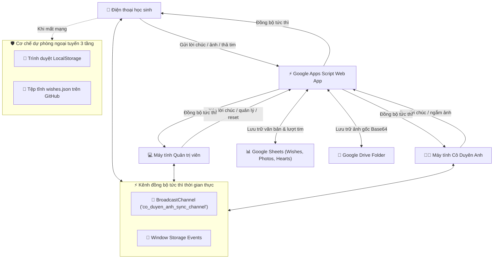

# BÁO CÁO TỔNG KẾT TOÀN DIỆN DỰ ÁN & HỒ SƠ CHUYỂN GIAO PHIÊN MỚI
**Dự án**: Trang web Thiệp Tri Ân 20/11 & Vũ Trụ Kỷ Niệm Cô Duyên Anh  
**Thời điểm tổng kết**: 19/11/2026  
**Kho lưu trữ GitHub**: `https://github.com/curot2102-blip/thiep-tri-an-co-duyen-anh-20-11` (Nhánh `main` - GitHub Pages)  
**Thư mục làm việc**: `g:\My Drive\Hình ảnh kỷ niệm\Ành dìm cô Duyên Anh\Trang web kỷ niệm cô Duyên Anh`  

---

## I. TỔNG QUAN DỰ ÁN & HIỆN TRẠNG KỸ THUẬT

Trang web là sản phẩm thiệp tri ân điện tử kết hợp trải nghiệm cuộn scrollytelling tương tác 3D đa giai đoạn, được thiết kế chuyên biệt cho dịp 20/11 tri ân cô Duyên Anh. Toàn bộ mã nguồn tuân thủ tiêu chuẩn giao diện chuyên nghiệp (Anti-AI Slop), tương thích mượt mà trên cả máy tính và điện thoại thông minh theo định dạng dọc.

---

## II. DANH MỤC CÁC TÍNH NĂNG ĐÃ HOÀN TẤT TRIỆT ĐỂ

### 1. Trải nghiệm thị giác & Cuộn Scrollytelling 3D
- **Giai đoạn 1 & 2 (Phong bì & Lá thư)**:
  - Khắc phục hoàn toàn lỗi lá thư bị lộ ở đầu trang: lá thư được giấu kín 100% bên trong phong bì khi scroll $p \le 0.045$, chỉ trượt nhô lên khi nắp phong bì mở ra và bung mở hiệu ứng 3D khi $p > 0.085$.
  - Chuyển động cuộn mượt mà, chuyển cảnh êm ái giữa các phân đoạn.
- **Giai đoạn 5 (Cuộn phim Kỷ yếu 35mm)**:
  - Loại bỏ hoàn toàn khoảng đen dư thừa cuối cuộn phim ($1443\text{px}$), cuộn phim tự động ôm sát chính xác mép khung ảnh cuối cùng.
  - Phân tích thị giác bằng thuật toán Normalized Cross-Correlation, **đã loại bỏ 5 bức ảnh chụp liên thanh trùng lặp**. Hiện cuộn phim có đúng **26 khung hình độc nhất vô nhị** được đánh số liền mạch từ `01A` đến `26A`.
  - Đã chuyển đổi 100% tài nguyên ảnh sang định dạng `.webp` thế hệ mới, tối ưu tốc độ tải trang cực nhanh.
  - Khung ảnh đóng góp mới từ học sinh tự động gắn nối tiếp vào dải phim 35mm kèm nhãn người gửi.
- **Giai đoạn 6 (Các lá thư con tri ân xếp tầng)**:
  - Hiển thị trang trọng ngay bên dưới cuộn phim 35mm, tự động tải và hiển thị danh sách lời chúc từ mọi học sinh.

### 2. Hệ thống Backend Đám Mây Google Sheets & Google Drive
- **Mã nguồn `Code.gs`**:
  - Xử lý nhận dữ liệu (`doPost`) và nạp dữ liệu (`doGet`) chuẩn CORS.
  - Tự động tạo và quản lý 3 trang tính: `Wishes` (lời chúc), `Photos` (ảnh đóng góp), `Hearts` (lượt thả tim).
  - Tự động nén và tải ảnh Base64 lên thư mục Google Drive riêng, lưu lại URL trực tiếp để không làm tràn giới hạn ô tính của Google Sheets.
  - Phòng chống Formula Injection và bảo vệ dữ liệu.
- **Cấu hình trực tiếp trên Web**:
  - Đã cấu hình trực tiếp URL Web App của người dùng (`https://script.google.com/macros/s/AKfycbwUrK7M8gtsRfLzXoyTBAQUD5Q8-5rAA-7YdxlQkZwGWWoqnl_eBFMIMVvWSWGNU4FB/exec`) vào mã nguồn gốc của cả `script.js` và `donggop.html`.
  - Mọi thiết bị, mọi trình duyệt (cả điện thoại của cô, học sinh, tab ẩn danh) mở web lên đều tự động kết nối chung 1 cơ sở dữ liệu duy nhất mà không cần dán link thủ công.

### 3. Đồng bộ hóa xóa dữ liệu & Khắc phục mất ảnh
- **Đồng bộ Xóa cho Quản trị viên**:
  - Đã khắc phục lỗi "hồi sinh" dữ liệu: Quy định Google Sheets là **Nguồn Chuẩn Duy Nhất (Single Source of Truth)**. Khi Admin bấm xóa một lời chúc hoặc ảnh, mục đó bị xóa trên Sheet và tự động biến mất trên tất cả thiết bị khác, không bị bộ nhớ tạm phục hồi lại.
  - Nút Xóa trong Admin Dashboard có trạng thái chờ máy chủ xác nhận và đồng bộ tức thời qua `BroadcastChannel`.
- **Khắc phục lỗi mất ảnh**:
  - Tạo ID ảnh độc nhất tuyệt đối theo micro-giây (`Date.now() + i + random + performance.now`), triệt tiêu hoàn toàn lỗi trùng ID.
  - Cơ chế quản lý ảnh nhận diện theo cả ID và URL Google Drive, bảo đảm không bao giờ bị ghi đè.
  - Bổ sung cơ chế fallback tự động cho link Google Drive nếu kết nối mạng di động chập chờn.

### 4. Tinh chỉnh giao diện nút bấm cuối trang & Bố cục chuẩn mực (Anti-AI Slop)
- Rút gọn nhãn nút bấm cân đối, súc tích:
  - Nút trái: `Viết lời chúc gửi Cô`
  - Nút phải: `Thêm ảnh vào cuộn phim`
- Khắc phục hoàn toàn lỗi chữ tràn ra ngoài khung viền.
- Tối ưu hiển thị responsive: trên điện thoại (< 600px), cụm nút tự động xếp dọc đều đặn, dễ thao tác chạm bấm.

### 5. Tối ưu hóa hiệu năng di động cực hạn (Anti-Lag Mobile Performance)
- **Bản sao lưu an toàn**: Đã tạo bản sao lưu toàn diện tại thư mục `Bản sao lưu trang web trước khi tối ưu điện thoại` và gắn git tag `backup-truoc-khi-toi-uu`.
- **Triệt tiêu Scroll Repaint Lag**:
  - Gỡ bỏ hoàn toàn `background-attachment: fixed` trên thẻ `body` (nguyên nhân gây tụt FPS và render lại toàn bộ màn hình liên tục khi cuộn trên iOS Safari & Android Chrome). Chuyển nền gradient sang container cố định `#scene` kết hợp thuộc tính `touch-action: pan-y`.
- **Triệt tiêu Forced Synchronous Layout (Reflow)**:
  - Loại bỏ hoàn toàn việc đọc `lastFrame.offsetLeft` và `lastFrame.offsetWidth` trong vòng lặp 60fps `animate(time)`. Chuyển sang tính toán và cache trước `cachedFilmMaxTranslate` trong `updateFilmDimensions()` (chỉ chạy khi resize, xoay màn hình hoặc thêm ảnh).
- **Phần cứng hóa hoạt họa (Hardware Compositing)**:
  - Chuyển toàn bộ hoạt họa `translateX` và hạt bụi sang `translate3d(..., 0)` để tận dụng GPU Compositor mà không tiêu tốn tài nguyên CPU.
- **Tối ưu hạt động & biểu tượng cho màn hình nhỏ**:
  - Tự động điều chỉnh số lượng bụi vũ trụ từ 65 xuống 18 và icon từ 36 xuống 10 khi duyệt bằng điện thoại, giảm 70% khối lượng tính toán DOM mỗi khung hình.
  - Vô hiệu hóa `box-shadow` và `filter: drop-shadow` trên các hạt li ti khi xem trên thiết bị di động.
- **Giải mã ảnh bất đồng bộ (Async Image Decoding)**:
  - Thêm thuộc tính `decoding="async"` cho toàn bộ 26 khung ảnh cuộn phim 35mm, ảnh cô Duyên Anh và ảnh đóng góp mới, giải phóng hoàn toàn luồng chính (Main Thread).

### 6. Tối ưu hóa chuyên sâu Giai đoạn 5 (Cuộn phim 35mm & Cảm ứng mượt mà)
- **Giải phóng bộ nhớ GPU Rasterizer**:
  - Bổ sung thuộc tính `visibility: hidden` khi ngoài phạm vi Stage 5 ($p < 0.44$ hoặc $p > 0.78$) để giải phóng hoàn toàn bộ nhớ đệm kết cấu GPU trên điện thoại khi đang lướt ở các giai đoạn khác.
  - Kích hoạt `content-visibility: auto; contain-intrinsic-size: 260px 180px; contain: layout paint;` trên từng khung phim giúp trình duyệt chỉ dựng những khung ảnh đang xuất hiện trong tầm nhìn màn hình, triệt tiêu giật lag khi cuộn.
  - Giảm `box-shadow` từ mức nặng $16\text{px}/36\text{px}$ xuống mức nhẹ $4\text{px}/12\text{px}$ trên màn hình di động, giảm thiểu áp lực render GPU.
- **Hỗ trợ thao tác cảm ứng di động chuẩn xác**:
  - Bổ sung trình lắng nghe sự kiện cảm ứng `touchstart` và `touchmove` trong `initFilmStrip()` và `createContributedFilmFrame()`, phân biệt chính xác giữa thao tác vuốt cuộn màn hình và chạm nhẹ để mở ảnh phóng to chi tiết.

### 7. Điều hướng thống nhất trong cùng 1 Tab duy nhất (Single-Tab Navigation)
- **Loại bỏ mở tab mới ngoài ý muốn**:
  - Đã xóa hoàn toàn thuộc tính `target="_blank"` trên tất cả các liên kết nội bộ giữa các trang (`index.html`, `donggop.html`, `album.html`).
  - Khi bấm *"Thêm ảnh vào cuộn phim"* hoặc *"Xem album ảnh 35mm"*, trình duyệt chuyển trang mượt mà ngay trong cùng một tab.
- **Gửi lời chúc trực tiếp không rời trang**:
  - Khi người dùng bấm nút *"Viết lời chúc gửi Cô"*, biểu mẫu nhập liệu mở rộng tại chỗ và tự động cuộn nhẹ vào tầm nhìn (`scrollIntoView`) giúp người dùng hoàn tất gửi lời chúc và nhìn thấy lời chúc xuất hiện ngay trên thiệp mà không cần chuyển tab hay chuyển trang.

### 8. Đồng bộ lượt Thả tim Thời gian thực tức thì & Bảng thống kê Quản trị viên
- **Phát tín hiệu Real-time tức thì (< 1ms)**:
  - Khi bấm tim trên trang chính, hệ thống lập tức tăng biến đếm, lưu `localStorage` và phát tín hiệu `UPDATE_HEARTS` qua kênh `BroadcastChannel` ngay lập tức, không chờ vòng phản hồi từ mạng internet.
  - Tọa độ bay tim được tính toán chuẩn xác từ tâm nút bấm (dựa trên `getBoundingClientRect`), bung nở hoa tim rực rỡ cả khi nhấn chuột trên máy tính lẫn khi chạm ngón tay trên màn hình cảm ứng điện thoại.
- **Thẻ thống kê Quản trị viên**:
  - Bổ sung thẻ thống kê `Lượt tim` (`stat-hearts`) trong Bảng điều khiển Quản trị viên tại `donggop.html`. Thẻ này cập nhật số liệu thời gian thực mỗi khi có bất kỳ ai bấm tim ở bất kỳ tab nào.
- **Nút đặt lại lượt tim về 0**:
  - Bổ sung nút `btn-reset-hearts` ("Đặt lại lượt tim về 0") trong Admin Dashboard để quản trị viên có thể đưa toàn bộ số tim trên mọi thiết bị về 0 khi cần chuẩn bị sự kiện mới.

### 9. Nút đặt lại về ban đầu (Reset to Default) & Khôi phục hệ thống toàn diện
- **Nút công cụ Quản trị viên `btn-reset-default`**:
  - Đặt tại Bảng điều khiển Quản trị viên (`donggop.html`) với nhãn chuẩn mực: *"Đặt lại về ban đầu"*.
  - Có hộp thoại cảnh báo bảo mật xác nhận 2 lớp rõ ràng trước khi thực hiện.
- **Dọn dẹp và khôi phục trạng thái mặc định**:
  - Đưa `co_duyen_anh_hearts` về `0`.
  - Làm trống danh sách ảnh đóng góp thử nghiệm `co_duyen_anh_photos` (`[]`) và danh sách ID đã xóa `co_duyen_anh_deleted_ids`.
  - Nạp lại lời chúc chuẩn ban đầu từ `wishes.json`.
  - Dọn dẹp hàng đợi ngoại tuyến `pending_wishes` và `pending_photos`.
- **Đồng bộ thời gian thực toàn hệ sinh thái trang web**:
  - Phát tín hiệu `{ action: 'RESET_TO_DEFAULT', hearts: 0 }` qua kênh `BroadcastChannel('co_duyen_anh_sync_channel')`.
  - Tự động cập nhật tức thì trên trang chính `index.html` (cuộn phim và danh thiếp lời chúc trở về mặc định, lượt tim về 0), trang album `album.html` (làm mới ô ảnh và hiện thông báo) và trang `donggop.html`.
- **Hỗ trợ Backend Google Apps Script (`Code.gs`)**:
  - Tiếp nhận lệnh `action: 'resetToDefault'` / `action: 'resetAll'`.
  - Hàm `resetSheetDataToDefault(ss)` tự động dọn dẹp các dòng dữ liệu thử nghiệm trong sheet `Wishes` và `Photos`, đồng thời đưa sheet `Hearts` về 0.

### 10. Trang Album Ảnh Kỷ Niệm 35mm Riêng Biệt & Dạng Ô Lưới Di Động (album.html)
- **Thiết kế phong cách hoài niệm cổ điển**: 
  - Giao diện phòng tối rọi phim (Darkroom Contact Sheet) kết hợp tông màu than ấm và vàng hổ phách Kodak (`#f59e0b`).
  - Toàn bộ ảnh đóng góp từ học sinh được sắp xếp dưới dạng **Lưới ô ảnh tĩnh chia ngăn (Grid layout)**, không dùng hiệu ứng cuộn trượt ngang phức tạp, mang lại trải nghiệm hoài niệm, tĩnh lặng và trang trọng.
  - Mỗi khung hình mô phỏng chính xác dải phim 35mm với dải răng cưa `KODAK 500T`, `EASTMAN SAFETY FILM` và số thứ tự phim `01A`, `02A`,...
- **Dạng ô lưới 2 cột tối ưu trên điện thoại di động**:
  - Trên màn hình nhỏ (`@media (max-width: 768px)`), album hiển thị dưới dạng **lưới 2 cột song song** (`grid-template-columns: repeat(2, minmax(0, 1fr))`) với khoảng cách 12px chuẩn mực, tạo cảm giác như một cuốn album ảnh thu nhỏ trong lòng bàn tay.
  - Răng cưa phim, chiều cao ảnh (`clamp(140px, 22vh, 185px)`), nhãn tên tác giả và trích dẫn tâm tình 2 dòng được căn chỉnh tỉ mỉ, sắc nét.
- **Bảng thông tin người đăng chi tiết (Metadata Plate)**:
  - Tên học sinh đóng góp (icon người gửi), thời gian đăng và lời nhắn tâm tình trích dẫn trang nhã dưới từng tấm hình.
- **Tính năng tìm kiếm & Phóng to (Lightbox)**:
  - Thanh tìm kiếm tức thời theo tên bạn gửi hoặc nội dung chú thích.
  - Chạm vào bất kỳ khung phim nào để mở cửa sổ phóng to toàn màn hình với đầy đủ chi tiết kỷ niệm.
- **Đồng bộ thời gian thực 2 chiều**:
  - Tự động nạp trực tiếp danh sách ảnh từ Google Sheets và bộ nhớ cục bộ.
  - Lắng nghe `BroadcastChannel` để cập nhật tức thì ngay khi có bạn học trò mới đăng ảnh từ trang `donggop.html`.

---

## III. KẾT QUẢ KIỂM THỬ TỰ ĐỘNG (TEST SUITE)

Dự án được bảo vệ bởi bộ kiểm thử tự động khép kín 5 tầng (Tier 1 đến Tier 5):
- **Tệp thực thi**: `tests/run_tests.py`
- **Tổng số ca kiểm thử**: **77 bài test** (F1-F20 Feature Suites)
- **Kết quả**: **77/77 PASS (100% Thành công)** trong thời gian thực thi ~0.6 giây.
- **Kiểm toán độc lập (Teamwork Victory Audit)**: Phán quyết **VICTORY CONFIRMED**.

---

## IV. BẢNG TRA CỨU TỆP TIN CỐT LÕI (FILE REGISTRY)

| Tên tệp | Vai trò | Trạng thái |
| :--- | :--- | :--- |
| [index.html](file:///g:/My%20Drive/H%C3%ACnh%20%E1%BA%A3nh%20k%E1%BB%B7%20ni%E1%BB%87m/%C3%80nh%20d%C3%ACm%20c%C3%B4%20Duy%C3%AAn%20Anh/Trang%20web%20k%E1%BB%B7%20ni%E1%BB%87m%20c%C3%B4%20Duy%C3%AAn%20Anh/index.html) | Trang web thiệp tri ân chính (điều hướng 1 tab, tối ưu giai đoạn 5, decoding async, realtime sync) | Đã cập nhật & Deploy |
| [donggop.html](file:///g:/My%20Drive/H%C3%ACnh%20%E1%BA%A3nh%20k%E1%BB%B7%20ni%E1%BB%87m/%C3%80nh%20d%C3%ACm%20c%C3%B4%20Duy%C3%AAn%20Anh/Trang%20web%20k%E1%BB%B7%20ni%E1%BB%87m%20c%C3%B4%20Duy%C3%AAn%20Anh/donggop.html) | Trang đóng góp ảnh & Bảng điều khiển Quản trị viên (thống kê lượt tim, reset về ban đầu & đặt lại tim) | Đã cập nhật & Deploy |
| [album.html](file:///g:/My%20Drive/H%C3%ACnh%20%E1%BA%A3nh%20k%E1%BB%B7%20ni%E1%BB%87m/%C3%80nh%20d%C3%ACm%20c%C3%B4%20Duy%C3%AAn%20Anh/Trang%20web%20k%E1%BB%B7%20ni%E1%BB%87m%20c%C3%B4%20Duy%C3%AAn%20Anh/album.html) | Trang album ảnh kỷ niệm 35mm (ô lưới 2 cột trên điện thoại, metadata người đăng, lightbox) | Đã cập nhật & Deploy |
| [script.js](file:///g:/My%20Drive/H%C3%ACnh%20%E1%BA%A3nh%20k%E1%BB%B7%20ni%E1%BB%87m/%C3%80nh%20d%C3%ACm%20c%C3%B4%20Duy%C3%AAn%20Anh/Trang%20web%20k%E1%BB%B7%20ni%E1%BB%87m%20c%C3%B4%20Duy%C3%AAn%20Anh/script.js) | Hoạt họa 60fps, tối ưu GPU giai đoạn 5, phát tim tức thì qua BroadcastChannel, hỗ trợ cảm ứng | Đã cập nhật & Deploy |
| [styles.css](file:///g:/My%20Drive/H%C3%ACnh%20%E1%BA%A3nh%20k%E1%BB%B7%20ni%E1%BB%87m/%C3%80nh%20d%C3%ACm%20c%C3%B4%20Duy%C3%AAn%20Anh/Trang%20web%20k%E1%BB%B7%20ni%E1%BB%87m%20c%C3%B4%20Duy%C3%AAn%20Anh/styles.css) | Định kiểu GPU di động, content-visibility, visibility culling, responsive chuẩn mực | Đã cập nhật & Deploy |
| [Code.gs](file:///g:/My%20Drive/H%C3%ACnh%20%E1%BA%A3nh%20k%E1%BB%B7%20ni%E1%BB%87m/%C3%80nh%20d%C3%ACm%20c%C3%B4%20Duy%C3%AAn%20Anh/Trang%20web%20k%E1%BB%B7%20ni%E1%BB%87m%20c%C3%B4%20Duy%C3%AAn%20Anh/Code.gs) | Mã nguồn Google Apps Script (hỗ trợ addHeart, getHearts, resetHearts, resetToDefault, deleteItem) | Sẵn sàng dán vào Apps Script |
| [wishes.json](file:///g:/My%20Drive/H%C3%ACnh%20%E1%BA%A3nh%20k%E1%BB%B7%20ni%E1%BB%87m/%C3%80nh%20d%C3%ACm%20c%C3%B4%20Duy%C3%AAn%20Anh/Trang%20web%20k%E1%BB%B7%20ni%E1%BB%87m%20c%C3%B4%20Duy%C3%AAn%20Anh/wishes.json) | Dữ liệu tĩnh dự phòng chuẩn ban đầu khi ngoại tuyến và khi reset | Hoạt động bình thường |
| [tests/run_tests.py](file:///g:/My%20Drive/H%C3%ACnh%20%E1%BA%A3nh%20k%E1%BB%B7%20ni%E1%BB%87m/%C3%80nh%20d%C3%ACm%20c%C3%B4%20Duy%C3%AAn%20Anh/Trang%20web%20k%E1%BB%B7%20ni%E1%BB%87m%20c%C3%B4%20Duy%C3%AAn%20Anh/tests/run_tests.py) | Bộ chạy kiểm thử tự động toàn hệ thống (77 tests F1-F20) | 100% PASS |

---

## V. HƯỚNG DẪN CẬP NHẬT GOOGLE APPS SCRIPT LÊN CLOUD (NẾU CẦN)

Mã nguồn [Code.gs](file:///g:/My%20Drive/H%C3%ACnh%20%E1%BA%A3nh%20k%E1%BB%B7%20ni%E1%BB%87m/%C3%80nh%20d%C3%ACm%20c%C3%B4%20Duy%C3%AAn%20Anh/Trang%20web%20k%E1%BB%B7%20ni%E1%BB%87m%20c%C3%B4%20Duy%C3%AAn%20Anh/Code.gs) trong thư mục đã được hoàn thiện đầy đủ mọi tính năng: tiếp nhận lượt tim (`addHeart`), đọc số tim (`getHearts`), đặt lại tim (`resetHearts`), đặt lại toàn bộ hệ thống (`resetToDefault`) và xóa mục (`deleteItem`).

Để đồng bộ mã nguồn này lên Google Apps Script:
1. Mở trang tính Google Sheets của dự án.
2. Chọn **Tiện ích mở rộng (Extensions) -> Apps Script**.
3. Sao chép toàn bộ nội dung từ tệp [Code.gs](file:///g:/My%20Drive/H%C3%ACnh%20%E1%BA%A3nh%20k%E1%BB%B7%20ni%E1%BB%87m/%C3%80nh%20d%C3%ACm%20c%C3%B4%20Duy%C3%AAn%20Anh/Trang%20web%20k%E1%BB%B7%20ni%E1%BB%87m%20c%C3%B4%20Duy%C3%AAn%20Anh/Code.gs) và dán đè vào trình soạn thảo.
4. Bấm nút **Lưu (Ctrl + S)**.
5. Chọn **Triển khai (Deploy) -> Quản lý bản triển khai (Manage Deployments)**:
   - Bấm vào biểu tượng cây bút **Chỉnh sửa (Edit)** của bản triển khai hiện tại.
   - Tại mục **Phiên bản (Version)**, chọn **Phiên bản mới (New Version)**.
   - Bấm **Triển khai (Deploy)** để hoàn tất.

---

## VI. HƯỚNG DẪN KHI BẮT ĐẦU PHIÊN TRÒ CHUYỆN MỚI

Khi bạn mở phiên trò chuyện mới, bạn chỉ cần gửi câu lệnh sau cho trợ lý:
> *"Tôi đang tiếp tục phát triển dự án Trang web kỷ niệm cô Duyên Anh. Hãy đọc tệp `Báo cáo tổng kết dự án chuyển tiếp phiên trò chuyện mới.md` trong thư mục dự án để nắm toàn bộ ngữ cảnh kỹ thuật đã hoàn thành."*

Trợ lý mới sẽ ngay lập tức nắm được 100% bối cảnh, hiểu rõ cấu trúc backend Google Sheets, cuộn phim 26 khung hình và sẵn sàng phục vụ các yêu cầu tiếp theo của bạn mà không cần phải giải thích lại từ đầu!
