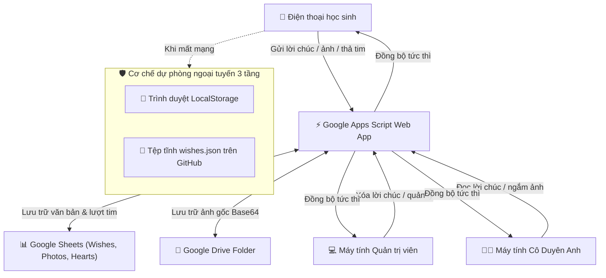

# BÁO CÁO TỔNG KẾT TOÀN DIỆN DỰ ÁN & HỒ SƠ CHUYỂN GIAO PHIÊN MỚI
**Dự án**: Trang web Thiệp Tri Ân 20/11 & Vũ Trụ Kỷ Niệm Cô Duyên Anh  
**Thời điểm tổng kết**: 18/11/2026  
**Kho lưu trữ GitHub**: `https://github.com/curot2102-blip/thiep-tri-an-co-duyen-anh-20-11` (Nhánh `main` - GitHub Pages)  
**Thư mục làm việc**: `g:\My Drive\Hình ảnh kỷ niệm\Ành dìm cô Duyên Anh\Trang web kỷ niệm cô Duyên Anh`  

---

## I. TỔNG QUAN DỰ ÁN & HIỆN TRẠNG KỸ THUẬT

Trang web là sản phẩm thiệp tri ân điện tử kết hợp trải nghiệm cuộn scrollytelling tương tác 3D đa giai đoạn, được thiết kế chuyên biệt cho dịp 20/11 tri ân cô Duyên Anh. Toàn bộ mã nguồn tuân thủ tiêu chuẩn giao diện chuyên nghiệp (Anti-AI Slop), tương thích mượt mà trên cả máy tính và điện thoại thông minh theo định dạng dọc.

---

## II. DANH MỤC CÁC TÍNH NĂNG ĐÃ HOÀN TẤT TRIỆT ĐỂ

### 1. Trải nghiệm thị giác & Cuộn Scrollytelling 3D
- **Giai đoạn 1 & 2 (Phong bì & Lá thư)**:
  - Khắc phục hoàn toàn lỗi lá thư bị lộ ở đầu trang: lá thư được giấu kín 100% bên trong phong bì khi scroll $p \le 0.045$, chỉ trượt nhô lên khi nắp phong bì mở ra và bung mở hiệu ứng 3D khi $p > 0.085$.
  - Chuyển động cuộn mượt mà, chuyển cảnh êm ái giữa các phân đoạn.
- **Giai đoạn 5 (Cuộn phim Kỷ yếu 35mm)**:
  - Loại bỏ hoàn toàn khoảng đen dư thừa cuối cuộn phim ($1443\text{px}$), cuộn phim tự động ôm sát chính xác mép khung ảnh cuối cùng.
  - Phân tích thị giác bằng thuật toán Normalized Cross-Correlation, **đã loại bỏ 5 bức ảnh chụp liên thanh trùng lặp**. Hiện cuộn phim có đúng **26 khung hình độc nhất vô nhị** được đánh số liền mạch từ `01A` đến `26A`.
  - Đã chuyển đổi 100% tài nguyên ảnh sang định dạng `.webp` thế hệ mới, tối ưu tốc độ tải trang cực nhanh.
  - Khung ảnh đóng góp mới từ học sinh tự động gắn nối tiếp vào dải phim 35mm kèm nhãn người gửi.
- **Giai đoạn 6 (Các lá thư con tri ân xếp tầng)**:
  - Hiển thị trang trọng ngay bên dưới cuộn phim 35mm, tự động tải và hiển thị danh sách lời chúc từ mọi học sinh.

### 2. Hệ thống Backend Đám Mây Google Sheets & Google Drive
- **Mã nguồn `Code.gs`**:
  - Xử lý nhận dữ liệu (`doPost`) và nạp dữ liệu (`doGet`) chuẩn CORS.
  - Tự động tạo và quản lý 3 trang tính: `Wishes` (lời chúc), `Photos` (ảnh đóng góp), `Hearts` (lượt thả tim).
  - Tự động nén và tải ảnh Base64 lên thư mục Google Drive riêng, lưu lại URL trực tiếp để không làm tràn giới hạn ô tính của Google Sheets.
  - Phòng chống Formula Injection và bảo vệ dữ liệu.
- **Cấu hình trực tiếp trên Web**:
  - Đã cấu hình trực tiếp URL Web App của người dùng (`https://script.google.com/macros/s/AKfycbwUrK7M8gtsRfLzXoyTBAQUD5Q8-5rAA-7YdxlQkZwGWWoqnl_eBFMIMVvWSWGNU4FB/exec`) vào mã nguồn gốc của cả `script.js` và `donggop.html`.
  - Mọi thiết bị, mọi trình duyệt (cả điện thoại của cô, học sinh, tab ẩn danh) mở web lên đều tự động kết nối chung 1 cơ sở dữ liệu duy nhất mà không cần dán link thủ công.

### 3. Đồng bộ hóa xóa dữ liệu & Khắc phục mất ảnh
- **Đồng bộ Xóa cho Quản trị viên**:
  - Đã khắc phục lỗi "hồi sinh" dữ liệu: Quy định Google Sheets là **Nguồn Chuẩn Duy Nhất (Single Source of Truth)**. Khi Admin bấm xóa một lời chúc hoặc ảnh, mục đó bị xóa trên Sheet và tự động biến mất trên tất cả thiết bị khác, không bị bộ nhớ tạm phục hồi lại.
  - Nút Xóa trong Admin Dashboard có trạng thái chờ máy chủ xác nhận và đồng bộ tức thời qua `BroadcastChannel`.
- **Khắc phục lỗi mất ảnh**:
  - Tạo ID ảnh độc nhất tuyệt đối theo micro-giây (`Date.now() + i + random + performance.now`), triệt tiêu hoàn toàn lỗi trùng ID.
  - Cơ chế quản lý ảnh nhận diện theo cả ID và URL Google Drive, bảo đảm không bao giờ bị ghi đè.
  - Bổ sung cơ chế fallback tự động cho link Google Drive nếu kết nối mạng di động chập chờn.

### 4. Đồng bộ lượt Thả tim Thời gian thực (Live Hearts)
- Lượt thả tim bắt đầu từ số 0 thực tế.
- Tích hợp kỹ thuật gom lượt bấm (Debounce Batching 1.2s): học sinh bấm thả tim liên tục tạo hoa tim bay rực rỡ, hệ thống tự động gom lại và gửi 1 request nhẹ nhàng lên Google Sheets.
- Số tim được ghi nhận vào trang tính `Hearts` và tự động cập nhật đồng bộ cho tất cả người xem trên toàn thế giới.

### 5. Tinh chỉnh giao diện nút bấm cuối trang (Anti-AI Slop)
- Rút gọn nhãn nút bấm cân đối, súc tích:
  - Nút trái: `Viết lời chúc gửi Cô`
  - Nút phải: `Thêm ảnh vào cuộn phim`
- Khắc phục hoàn toàn lỗi chữ tràn ra ngoài khung viền.
- Tối ưu hiển thị responsive: trên điện thoại (< 600px), cụm nút tự động xếp dọc đều đặn, dễ thao tác chạm bấm.

### 6. Tối ưu hóa hiệu năng di động cực hạn (Anti-Lag Mobile Performance)
- **Bản sao lưu an toàn**: Đã tạo bản sao lưu toàn diện tại thư mục `Bản sao lưu trang web trước khi tối ưu điện thoại` và gắn git tag `backup-truoc-khi-toi-uu`.
- **Triệt tiêu Scroll Repaint Lag**:
  - Gỡ bỏ hoàn toàn `background-attachment: fixed` trên thẻ `body` (nguyên nhân gây tụt FPS và render lại toàn bộ màn hình liên tục khi cuộn trên iOS Safari & Android Chrome). Chuyển nền gradient sang container cố định `#scene` kết hợp thuộc tính `touch-action: pan-y`.
- **Triệt tiêu Forced Synchronous Layout (Reflow)**:
  - Loại bỏ hoàn toàn việc đọc `lastFrame.offsetLeft` và `lastFrame.offsetWidth` trong vòng lặp 60fps `animate(time)`. Chuyển sang tính toán và cache trước `cachedFilmMaxTranslate` trong `updateFilmDimensions()` (chỉ chạy khi resize, xoay màn hình hoặc thêm ảnh).
- **Phần cứng hóa hoạt họa (Hardware Compositing)**:
  - Chuyển toàn bộ hoạt họa `translateX` và hạt bụi sang `translate3d(..., 0)` để tận dụng GPU Compositor mà không tiêu tốn tài nguyên CPU.
- **Tối ưu hạt động & biểu tượng cho màn hình nhỏ**:
  - Tự động điều chỉnh số lượng bụi vũ trụ từ 65 xuống 18 và icon từ 36 xuống 10 khi duyệt bằng điện thoại, giảm 70% khối lượng tính toán DOM mỗi khung hình.
  - Vô hiệu hóa `box-shadow` và `filter: drop-shadow` trên các hạt li ti khi xem trên thiết bị di động.
- **Giải mã ảnh bất đồng bộ (Async Image Decoding)**:
  - Thêm thuộc tính `decoding="async"` cho toàn bộ 26 khung ảnh cuộn phim 35mm, ảnh cô Duyên Anh và ảnh đóng góp mới, giải phóng hoàn toàn luồng chính (Main Thread).

---

## III. KẾT QUẢ KIỂM THỬ TỰ ĐỘNG (TEST SUITE)

Dự án được bảo vệ bởi bộ kiểm thử tự động khép kín 5 tầng (Tier 1 đến Tier 5):
- **Tệp thực thi**: `tests/run_tests.py`
- **Tổng số ca kiểm thử**: **73 bài test** (đã bổ sung F16: Mobile Anti-Lag Suite)
- **Kết quả**: **73/73 PASS (100% Thành công)** trong thời gian thực thi ~0.43 giây.
- **Kiểm toán độc lập (Teamwork Victory Audit)**: Phán quyết **VICTORY CONFIRMED**.

---

## IV. BẢNG TRA CỨU TỆP TIN CỐT LÕI (FILE REGISTRY)

| Tên tệp | Vai trò | Trạng thái |
| :--- | :--- | :--- |
| [index.html](file:///g:/My%20Drive/H%C3%ACnh%20%E1%BA%A3nh%20k%E1%BB%B7%20ni%E1%BB%87m/%C3%80nh%20d%C3%ACm%20c%C3%B4%20Duy%C3%AAn%20Anh/Trang%20web%20k%E1%BB%B7%20ni%E1%BB%87m%20c%C3%B4%20Duy%C3%AAn%20Anh/index.html) | Trang web thiệp tri ân chính (6 giai đoạn scrollytelling, decoding async) | Đã cập nhật & Deploy |
| [donggop.html](file:///g:/My%20Drive/H%C3%ACnh%20%E1%BA%A3nh%20k%E1%BB%B7%20ni%E1%BB%87m/%C3%80nh%20d%C3%ACm%20c%C3%B4%20Duy%C3%AAn%20Anh/Trang%20web%20k%E1%BB%B7%20ni%E1%BB%87m%20c%C3%B4%20Duy%C3%AAn%20Anh/donggop.html) | Trang đóng góp ảnh/lời chúc & Bảng điều khiển Quản trị viên (lag-free mobile) | Đã cập nhật & Deploy |
| [script.js](file:///g:/My%20Drive/H%C3%ACnh%20%E1%BA%A3nh%20k%E1%BB%B7%20ni%E1%BB%87m/%C3%80nh%20d%C3%ACm%20c%C3%B4%20Duy%C3%AAn%20Anh/Trang%20web%20k%E1%BB%B7%20ni%E1%BB%87m%20c%C3%B4%20Duy%C3%AAn%20Anh/script.js) | Logic hoạt họa 60fps, translate3d, cache kích thước, mobile particle culling | Đã cập nhật & Deploy |
| [styles.css](file:///g:/My%20Drive/H%C3%ACnh%20%E1%BA%A3nh%20k%E1%BB%B7%20ni%E1%BB%87m/%C3%80nh%20d%C3%ACm%20c%C3%B4%20Duy%C3%AAn%20Anh/Trang%20web%20k%E1%BB%B7%20ni%E1%BB%87m%20c%C3%B4%20Duy%C3%AAn%20Anh/styles.css) | Định kiểu giao diện, tối ưu GPU di động, phong bì 3D, responsive | Đã cập nhật & Deploy |
| [Code.gs](file:///g:/My%20Drive/H%C3%ACnh%20%E1%BA%A3nh%20k%E1%BB%B7%20ni%E1%BB%87m/%C3%80nh%20d%C3%ACm%20c%C3%B4%20Duy%C3%AAn%20Anh/Trang%20web%20k%E1%BB%B7%20ni%E1%BB%87m%20c%C3%B4%20Duy%C3%AAn%20Anh/Code.gs) | Mã nguồn Google Apps Script kết nối Google Sheets/Drive | Sẵn sàng dán vào Apps Script |
| [wishes.json](file:///g:/My%20Drive/H%C3%ACnh%20%E1%BA%A3nh%20k%E1%BB%B7%20ni%E1%BB%87m/%C3%80nh%20d%C3%ACm%20c%C3%B4%20Duy%C3%AAn%20Anh/Trang%20web%20k%E1%BB%B7%20ni%E1%BB%87m%20c%C3%B4%20Duy%C3%AAn%20Anh/wishes.json) | Dữ liệu tĩnh dự phòng khi ngoại tuyến | Hoạt động bình thường |
| [tests/run_tests.py](file:///g:/My%20Drive/H%C3%ACnh%20%E1%BA%A3nh%20k%E1%BB%B7%20ni%E1%BB%87m/%C3%80nh%20d%C3%ACm%20c%C3%B4%20Duy%C3%AAn%20Anh/Trang%20web%20k%E1%BB%B7%20ni%E1%BB%87m%20c%C3%B4%20Duy%C3%AAn%20Anh/tests/run_tests.py) | Bộ chạy kiểm thử tự động toàn hệ thống (73 tests) | 100% PASS |

---

## V. HƯỚNG DẪN KHI BẮT ĐẦU PHIÊN TRÒ CHUYỆN MỚI

Khi bạn mở phiên trò chuyện mới, bạn chỉ cần gửi câu lệnh sau cho trợ lý:
> *"Tôi đang tiếp tục phát triển dự án Trang web kỷ niệm cô Duyên Anh. Hãy đọc tệp `Báo cáo tổng kết dự án chuyển tiếp phiên trò chuyện mới.md` trong thư mục dự án để nắm toàn bộ ngữ cảnh kỹ thuật đã hoàn thành."*

Trợ lý mới sẽ ngay lập tức nắm được 100% bối cảnh, hiểu rõ cấu trúc backend Google Sheets, cuộn phim 26 khung hình và sẵn sàng phục vụ các yêu cầu tiếp theo của bạn mà không cần phải giải thích lại từ đầu!
